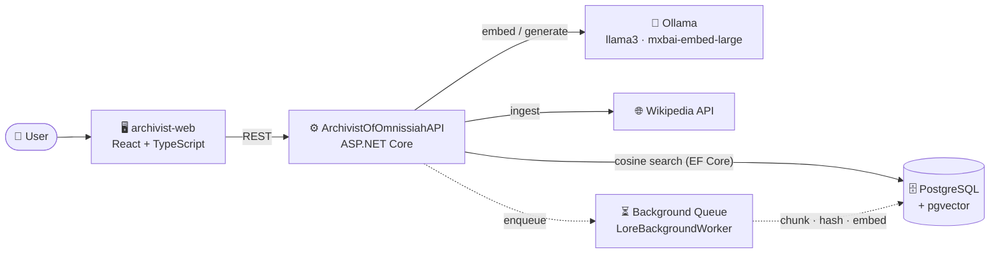
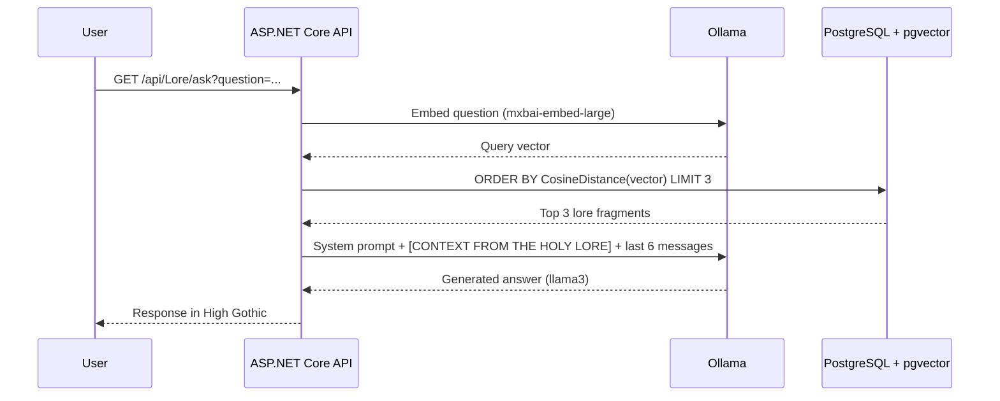

<div align="center">

# ⚙️ Archivist of the Omnissiah

### *A local-first RAG terminal powered by the Machine God*

**Archivist 0-1**, a Logis of the Adeptus Mechanicus, answers your questions from a sacred vector archive of Warhammer 40,000 lore, entirely on your own hardware.


```text
 01001111 01101101 01101110 01101001 01110011 01110011 01101001 01100001 01101000
        >> ESTABLISHING WARP-LINK ... NOOSPHERE ONLINE ... C# CORE: STABLE <<
```

</div>

---

## 📜 Table of Contents

- [About](#-about)
- [Features](#-features)
- [Architecture](#-architecture)
- [Tech Stack](#-tech-stack)
- [Getting Started](#-getting-started)
- [API Reference](#-api-reference)
- [How It Works](#-how-it-works)
- [Project Structure](#-project-structure)
- [License](#-license)

---

## 🔱 About

**Archivist of the Omnissiah** is a full-stack **Retrieval-Augmented Generation (RAG)** application wrapped in the grim aesthetics of the Adeptus Mechanicus.

Ask the Archivist about the Emperor, the Primarchs, or the Great Crusade. It searches a PostgreSQL vector database of lore, retrieves the most relevant fragments, and answers in the reverent tone of *High Gothic*, all powered by **local AI models** running through [Ollama](https://ollama.com). No cloud APIs, no data leaving your machine.

Behind the theatrical roleplay sits a technically solid pipeline: vector search, text chunking, deduplication, background job processing, and conversational memory management.

> *"From the weakness of the mind, Omnissiah save us. From the lies of the Antipath, circuit preserve us."*

---

## ✨ Features

| | Feature | Description |
|---|---|---|
| 🧠 | **Local AI** | Text generation with `llama3` and embeddings with `mxbai-embed-large`, both served by Ollama. |
| 🔎 | **Semantic RAG** | Questions are embedded and matched against the lore base using pgvector cosine distance. |
| 📚 | **Wikipedia Ingestion** | Feed the Machine Spirit any Wikipedia article through a single endpoint. |
| ✂️ | **Smart Chunking** | 1000-character chunks with 150-character overlap, preferring sentence boundaries. |
| 🧬 | **Deduplication** | SHA-256 hashing prevents the same fragment from entering the archive twice. |
| ⏳ | **Background Processing** | Long-running ingestion runs on a background queue; the API responds instantly. |
| 💬 | **Session Memory** | The last 6 messages of a session are passed to the model as context. |
| 🧹 | **Auto-pruning** | Sessions exceeding 50 messages automatically drop their 10 oldest entries. |
| ☠️ | **Heresy Detection** | Forbidden words trigger a `CRITICAL: WARP-TAINT DETECTED` protocol (see below). |
| 🖥️ | **Cogitator UI** | Retro CRT terminal with boot sequence, glitch effects, and typewriter output. |

---

## 🏛️ Architecture



### Retrieval flow



---

## 🛠️ Tech Stack

**Frontend**: `archivist-web`
- React with TypeScript
- Vite
- Tailwind CSS
- `react-simple-typewriter` for terminal-style text output

**Backend**: `ArchivistOfOmnissiahAPI`
- .NET 8 / 9, ASP.NET Core Web API
- Entity Framework Core with pgvector support
- Hosted background service with an `IBackgroundTaskQueue`

**Infrastructure**
- PostgreSQL with the `pgvector` extension (via Docker Compose)
- Ollama for fully local inference

---

## 🚀 Getting Started

### Prerequisites

- [.NET SDK 8 or 9](https://dotnet.microsoft.com/download)
- [Node.js](https://nodejs.org) (LTS recommended)
- [Docker](https://www.docker.com/) and Docker Compose
- [Ollama](https://ollama.com/download)

### 1. Clone the repository

```bash
git clone https://github.com/Nika-nerd/ArchivistOfOmnissiah/githttps:
cd ArchivistOfOmnissiah
```

### 2. Awaken the Machine Spirits (Ollama)

```bash
ollama pull llama3
ollama pull mxbai-embed-large
```

Ollama should be listening on `http://localhost:11434`.

### 3. Start the vector database

```bash
docker compose up -d
```

### 4. Run the backend

```bash
cd ArchivistOfOmnissiahAPI
dotnet ef database update   # apply migrations
dotnet run
```

### 5. Run the frontend

```bash
cd archivist-web
npm install
npm run dev
```

Open the URL printed by Vite and the Cogitator will boot. 🕯️

### 6. Feed the Archive

Before asking questions, give the Archivist some knowledge:

```bash
curl -X POST "http://localhost:<port>/api/Lore/ingest-wiki?topic=Horus%20Heresy"
```

> The exact route parameters may differ; check Swagger or the controller for the current signature.

---

## 📡 API Reference

| Method | Endpoint | Description |
|--------|----------|-------------|
| `GET` | `/api/Lore/ask` | Ask a question. The query is embedded, the 3 closest lore chunks are retrieved, and the model answers with that context. |
| `POST` | `/api/Lore/ingest-wiki` | Queue a Wikipedia article for ingestion. Returns immediately while processing continues in the background. |

---

## 🔬 How It Works

### 🧠 Roleplay & the Heresy Protocol

The persona is defined in a system prompt (`ChatService.cs`). The model plays **Archivist 0-1**, a Logis of the Adeptus Mechanicus.

- **Normal mode**: queries about the Emperor, the Primarchs, and so on are answered in respectful *High Gothic*, with reverence toward the Omnissiah.
- **Heresy mode**: a Regex scan checks each query for forbidden terms:

  `Chaos` · `Khorne` · `Tzeentch` · `Nurgle` · `Slaanesh` · `Daemon` · `Warp` · `Heretic`

  On a match, the threat level escalates to **`CRITICAL: WARP-TAINT DETECTED`**. The Archivist begins to malfunction: spewing binary noise (`0110`), stuttering (`er-r-rror`), lamenting the "screams of the noospheric filters", and accusing the user of seeking forbidden knowledge.

### 📚 Data Ingestion Pipeline

1. **Search & fetch**: find the article via the Wikipedia API and download plain text (`explaintext=1`, no HTML).
2. **Clean**: collapse repeated whitespace and blank lines with Regex.
3. **Chunk**: split into ~1000-character pieces with 150 characters of overlap, ending on a full stop where possible.
4. **Deduplicate**: compute a SHA-256 hash per chunk and skip anything already stored.
5. **Embed & store**: vectorize via Ollama and persist to PostgreSQL (`LoreEntry.Embedding`).
6. **Background execution**: the whole process runs through `IBackgroundTaskQueue` and `LoreBackgroundWorker`, so the HTTP request never blocks.

### 💬 Conversation Memory

- Each request loads the **last 6 messages** of the current `SessionId` into the prompt.
- When a session grows beyond **50 messages**, the **10 oldest** are deleted to keep the context window healthy.

### 🖥️ The Cogitator Terminal

- **Boot screen** with a BIOS-style Noosphere sequence and an Omnissiah emblem
- **Green CRT** styling with glitch overlays (`.glitchOverlay`) and a binary rain background (`BinaryBackground.tsx`)
- **Typewriter output** with an underscore cursor for every Archivist reply
- **Status panel** showing live metrics:

```text
WARP INF:   0.001%
C# CORE:    STABLE
MSG COUNT:  ##
VECTOR DB:  PG_VEC
```

---

## 🗂️ Project Structure

```text
.
├── archivist-web/                 # React + TypeScript frontend
│   └── src/
│       └── components/
│           ├── ArchivistTerminal.tsx
│           └── BinaryBackground.tsx
├── ArchivistOfOmnissiahAPI/       # ASP.NET Core backend
│   ├── Models/
│   │   └── LoreEntry.cs           # Entity with pgvector embedding
│   └── Services/
│       ├── ChatService.cs         # System prompt, heresy detection, memory
│       ├── WikiService.cs         # Fetching, cleaning, chunking, hashing
│       └── LoreBackgroundWorker.cs
└── docker-compose.yml             # PostgreSQL + pgvector
```

> File locations are indicative; adjust to match your repository layout.

---

## 🗺️ Roadmap Ideas

- [ ] Support more ingestion sources (PDFs, Lexicanum, custom text)
- [ ] Streaming responses from the model
- [ ] Source citations alongside answers
- [ ] Configurable models and retrieval depth

---

## 📄 License

Distributed under the license of your choice. Add a `LICENSE` file and update this section.

*Warhammer 40,000 is a trademark of Games Workshop Ltd. This is an unofficial fan project and is not affiliated with or endorsed by Games Workshop.*

---

<div align="center">

**✠ The Omnissiah protects. ✠**

*Praise the Machine God. Purge the heretic. Preserve the knowledge.*

</div>
